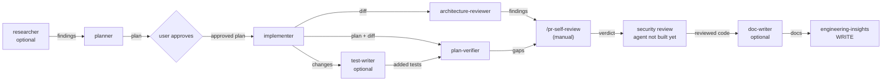

# .claude

Project setup for Claude Code. This file is a map; the behaviour lives in the linked files.

| Path | Contents |
|---|---|
| [`agents/`](agents/) | Subagent definitions (only agent files go here) |
| [`skills/`](skills/README.md) | Skill catalog and [Skill routing](skills/README.md#skill-routing) |
| `hooks/` | [`pr-gate.sh`](hooks/pr-gate.sh): blocks `gh pr create/merge` without a fresh PASS from `/pr-self-review`. Agent guards, wired in each agent's frontmatter and needing `jq`: [`implementer-guard.sh`](hooks/implementer-guard.sh), [`test-writer-guard.sh`](hooks/test-writer-guard.sh), [`arch-reviewer-guard.sh`](hooks/arch-reviewer-guard.sh), [`doc-writer-guard.sh`](hooks/doc-writer-guard.sh) |
| [`settings.json`](settings.json) | Project settings (wires `pr-gate.sh`) |

## Agents

Claude delegates based on each agent's `description`; name the agent to make sure it runs. Subagents cannot ask the user anything, so the main session relays their questions and sends the answers back to the same agent.

| Agent | Responsibility | Model | Tools | Invoked by |
|---|---|---|---|---|
| [`researcher`](agents/researcher.md) | Answers one question from the repo or external sources | sonnet | Read, Grep, Glob, Bash, WebSearch, WebFetch | main session |
| [`planner`](agents/planner.md) | Writes a Development Plan | opus | Read, Grep, Glob | main session |
| [`implementer`](agents/implementer.md) | Executes an approved plan and tests it | sonnet | Read, Grep, Glob, Edit, Write, Bash, Skill | main session, after the user approves the plan |
| [`test-writer`](agents/test-writer.md) | Adds tests for existing behaviour, never production code | sonnet | Read, Grep, Glob, Edit, Write, Bash, Skill | main session |
| [`architecture-reviewer`](agents/architecture-reviewer.md) | Checks architecture boundaries, with evidence | opus | Read, Grep, Glob, Bash | main session |
| [`plan-verifier`](agents/plan-verifier.md) | Checks code against every item of a plan | sonnet | Read, Grep, Glob | main session |
| [`doc-writer`](agents/doc-writer.md) | Documents features, with diagrams | sonnet | Read, Grep, Glob, Edit, Write | main session |
| [`pr-skill-reviewer`](agents/pr-skill-reviewer.md) | Reviews changed files against one skill | inherit | Read, Grep, Glob, Bash | `/pr-self-review` only |

`planner`, `implementer` and `architecture-reviewer` preload `onion-architecture` and `frontend-ui-architecture`; `doc-writer` preloads `mermaid-diagram`.

## Inputs and outputs

| Agent | Input | Output | Used by |
|---|---|---|---|
| `researcher` | A question, or `mode: interview` | `NEEDS CLARIFICATION`, `INTERVIEW` or a research report | user, main session |
| `planner` | Task and its context | `QUESTIONS` or a Development Plan | user, `implementer` |
| `implementer` | The full approved plan | Implementation Report (`DONE`, `PARTIAL`, `BLOCKED`, `FAILED`) and uncommitted changes | main session, `/pr-self-review` |
| `test-writer` | Target and the behaviours to cover | `QUESTIONS` or Test Report (`DONE`, `PARTIAL`, `BLOCKED`, `FAILED`) and uncommitted tests | main session |
| `architecture-reviewer` | `scope`, `files`, `diff` | Architecture Review (`PASS`, `FINDINGS`, `BLOCKED`) | user, main session |
| `plan-verifier` | Full plan, `files`, `diff`, optional `checks` | Plan Verification (`COMPLETE`, `INCOMPLETE`, `UNVERIFIED`, `BLOCKED`) | user, main session |
| `doc-writer` | `feature`, `state`, `sources` | `QUESTIONS` or Documentation Report (`DONE`, `PARTIAL`, `BLOCKED`) and uncommitted pages | user, main session |
| `pr-skill-reviewer` | `skill`, `files`, `diff` | JSON lines or `NONE` | `/pr-self-review` |

## Permissions and guardrails

No agent has the `Agent` tool, so none can spawn others.

| Agent | Cannot | Enforced by |
|---|---|---|
| `researcher` | Edit or write files, use skills | `tools` allowlist |
| `researcher` | Change anything through Bash | prompt only |
| `planner` | Run commands, edit files, use the web | `tools` allowlist |
| `implementer` | Commit, push, `gh`, install dependencies, hand-edit migrations, env files or lockfiles | hook (catches mistakes, not a sandbox) |
| `implementer` | Review architecture or security, write insights | prompt only |
| `test-writer` | Write anything but test files and helpers; run commands outside a fixed list | hook (a test it runs can still write: not a sandbox) |
| `test-writer` | Fix production code or weaken tests, commit | prompt; hook for the writes and commits |
| `architecture-reviewer` | Edit or write files | `tools` allowlist and hook |
| `architecture-reviewer` | Use Bash beyond dependency-cruiser (`--no-config`), read-only git, `ls`, `wc` | hook (not a sandbox) |
| `plan-verifier` | Edit, write, run commands | `tools` allowlist |
| `doc-writer` | Write outside `<package>/docs`, `<package>/specs`, `<package>/README.md` | hook |
| `doc-writer` | Run commands | `tools` allowlist |
| `pr-skill-reviewer` | Edit or write files | `tools` allowlist |
| `pr-skill-reviewer` | Change anything through Bash | prompt only |

## Workflow

Use `planner` and `implementer` for multi-file work. Small, well-specified edits are cheaper in the main session. `architecture-reviewer` and `plan-verifier` run in a fresh context; pass them the plan and the diff, because they see none of the conversation.

Both follow [Skill routing](skills/README.md#skill-routing), which includes the skills `/pr-self-review` checks.

## Sources for agents

Accessed 2026-11-26. These are living pages; rules are paraphrased.

- S1 [Subagents](https://code.claude.com/docs/en/sub-agents)
- S2 [Permission modes](https://code.claude.com/docs/en/permission-modes)
- S3 [Permissions](https://code.claude.com/docs/en/permissions)
- S4 [Claude Code best practices](https://code.claude.com/docs/en/best-practices)
- S5 [Skills](https://code.claude.com/docs/en/skills)
- S6 [Model configuration](https://code.claude.com/docs/en/model-config)
- S7 [Harness design for long-running apps](https://www.anthropic.com/engineering/harness-design-long-running-apps) (2026-03-24)
- S8 [When and how to use multi-agent systems](https://claude.com/blog/building-multi-agent-systems-when-and-how-to-use-them) (2026-01-23)
- S9 [Hooks reference](https://code.claude.com/docs/en/hooks)
- S10 [Code Review](https://code.claude.com/docs/en/code-review)
- S11 [Reduce hallucinations](https://platform.claude.com/docs/en/test-and-evaluate/strengthen-guardrails/reduce-hallucinations)
- S12 [Demystifying evals for AI agents](https://www.anthropic.com/engineering/demystifying-evals-for-ai-agents)
- S13 [Testing Library: queries](https://testing-library.com/docs/queries/about/)
- S14 [Vitest: mocking](https://vitest.dev/guide/mocking)
- S15 [Fastify: testing](https://fastify.dev/docs/latest/Guides/Testing/)
- S16 [Are coding agents generating over-mocked tests?](https://arxiv.org/abs/2602.00409) (preprint, 2026-01)
- S17 [dependency-cruiser rules reference](https://github.com/sverweij/dependency-cruiser/blob/main/doc/rules-reference.md)
- S18 [Diátaxis compass](https://diataxis.fr/compass/)
- S19 [Docs as code](https://www.writethedocs.org/guide/docs-as-code/)
- S20 [C4 diagram review checklist](https://c4model.com/diagrams/checklist)
- S21 [Mermaid C4 syntax and its limits](https://mermaid.js.org/syntax/c4.html)
- S22 [Architecture decision record](https://www.martinfowler.com/bliki/ArchitectureDecisionRecord.html)

| Rule | Source | Agent |
|---|---|---|
| P1 A `tools` allowlist is enforced; Bash lets an agent change files | S1 | both |
| P2 A subagent's `permissionMode` is ignored under auto, acceptEdits or bypass, so it is not set | S1, S2 | both |
| P3 Hard limits belong in hooks or deny rules, not prompt text | S3, S4 | implementer |
| P4 `skills:` preloads full skill text; other skills stay reachable through `Skill` | S1, S5 | both |
| P5 Subagents can nest, so `Agent` is left out | S1 | both |
| P6 Subagents cannot ask the user; they return questions and can be resumed | S1 | both |
| P7 `description` drives delegation: say when to use and when not to | S1 | both |
| P8 Plan deliverables and design, not fine implementation detail | S7 | planner |
| P9 Give a pass/fail check and ask for evidence | S4 | both |
| P10 Role splits cost tokens; the builder writes its tests, review is a fresh context | S8, S4 | both |
| P11 Calm wording; heavy emphasis causes over-application | S4 | both |
| P12 Opus for complex decisions, Sonnet for routine work | S6 | both |
| P13 Read-only means no Edit/Write and no `memory` (it enables them); Bash only behind an allowlist hook | S1, S3 | architecture-reviewer, plan-verifier |
| P14 A hook blocks with exit 2, should fail closed, and project frontmatter hooks run only in a trusted folder | S9 | test-writer, architecture-reviewer, doc-writer |
| P15 Run a deterministic tool first; the model explains and covers what it cannot see | S12, S17 | architecture-reviewer |
| P16 Quote with `file:line`, retract what cannot be quoted, allow "cannot verify" | S11 | architecture-reviewer, plan-verifier |
| P17 Review in a fresh context with a separate verification pass; self-grading skews positive | S7, S10 | architecture-reviewer, plan-verifier |
| P18 Test behaviour, mock at boundaries, follow RTL query priority, restore mocks | S13, S14, S16 | test-writer |
| P19 Drive Fastify with `inject()` and `close()` it | S15 | test-writer |
| P20 One row per plan item, only gaps against stated requirements, no general advice | S4 | plan-verifier |
| P21 One Diátaxis type per page, no empty sections | S18 | doc-writer |
| P22 Docs as code: claims rest on code, and code wins over documents | S19, S11 | doc-writer |
| P23 Context and container level, labelled arrows, flowchart instead of Mermaid C4 | S20, S21 | doc-writer |
| P24 A superseded decision is not rewritten; a new one is added | S22 | doc-writer |

In the table, "both" means `planner` and `implementer`. Not taken from a source: the per-role model choice (our reading of S6), the plan and report formats, the hook allowlists, the "red bug test means `PARTIAL`" rule and the `QUESTIONS`/`BLOCKED` convention.

## Adding an agent

1. List its `tools` explicitly; omitting the field grants everything.
2. Write a `description` that says when to use it and when not to.
3. Define its output format.
4. Add it to the tables above.
5. If it can write or has Bash, give it a guard hook, and check in a trusted folder that the hook really blocks.
6. Do not set `memory` on a reviewer: it enables Read, Write and Edit.
