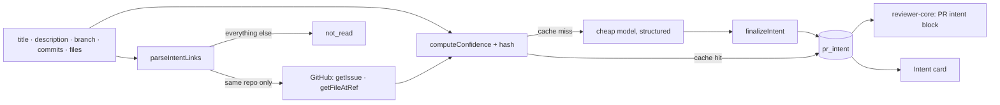
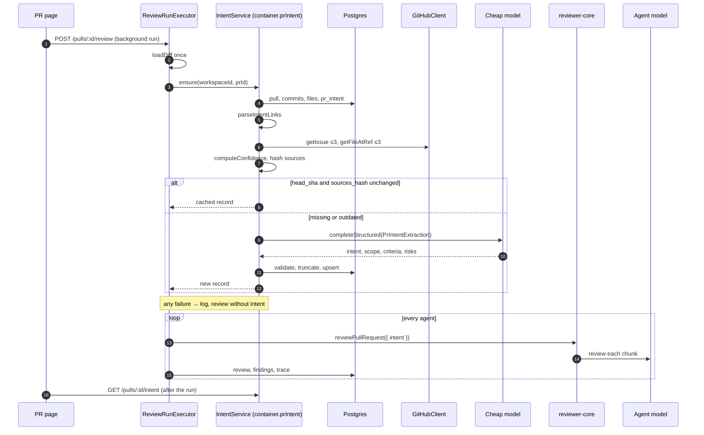

# 04 — Intent Layer (M3, Intent only)

## Goal
Before a review, derive why a PR exists (title, description, commits, linked GitHub
issues, spec/plan files of the same repo), give it to every review agent together with
the diff, and show it in an INTENT card on the PR Overview tab.

## Scope
In: `modules/intent`, `pr_intent` columns, `## PR intent` prompt slot, Intent card with
Risk Areas, run trace block, seed data for PR #482.
Out: Blast Radius, PR Brief, Smart Diff, fetching any non-GitHub URL, following links
found inside issues or specs.

## Decisions
- **Sources are GitHub only**, of the same repo. Owner/repo come from the DB. Spec files
  are read through the contents API at the PR head SHA (the clone is shallow and its
  working tree is the default branch).
- **Computed during review (once per PR, cached) or by Recalculate.** Opening a PR never
  calls a model.
- **Cache key:** `head_sha` + hash of the truncated inputs, model choice and prompt
  version. A transient GitHub failure never overwrites a stored intent of the same head.
- **Confidence is computed by code**, not the model:

| Level | Condition |
|---|---|
| `stated` | a target issue or spec was read, or the description is substantive (≥120 chars without template noise). A spec edited by the PR counts like the description |
| `partial` | a mentioned issue, a 20–119 char description, or meaningful commits |
| `inferred` | only title, branch, paths and diff: out-of-scope and acceptance criteria stay empty, no scope findings |

- **Intent never lowers severity or removes findings.** The rule is held by the prompt;
  code does not filter findings by intent.
- **Failure is not fatal:** the review runs without intent and logs one `info` line.
- **Logs carry references and lengths only**, never body, issue or spec content.
- Model: feature `review_intent`, default `openrouter / deepseek/deepseek-v4-flash`.
  Prompt: `server/src/prompts/intent.system.md`.

## Limits
| Source | Limit |
|---|---|
| title | 300 chars |
| description | 4000 chars |
| commits | 20 × 200 chars |
| changed files | 100 paths; patch 1500 per file, 12000 total |
| issues | 3 (targets first), body 4000 |
| spec files | 3 files, 200 KB, 8000 per file, 20000 total |
| other URLs | listed as `not_read`, max 10 |

Spec files are found as markdown links, paths, same-repo blob URLs and bare root file
names (`PLAN.md`; boilerplate such as `README.md` or `CLAUDE.md` is ignored when bare).
In a blob URL the PR's head and base branch names are matched exactly; for another
branch containing `/` with a usual prefix (`feat/`, `release/`, …), longer splits are
tried until a file is found.

## Data flow

## Call sequence

## API
- `GET  /pulls/:id/intent` → `{intent}`; `stale` = stored `head_sha` ≠ PR head. 404.
- `POST /pulls/:id/intent/recalculate` → record (rate limit 5/min). 404;
  409 `intent_model_unavailable` (no provider key); 502 (model call or answer failed).
- `POST /pulls/:id/review` is unchanged.

## Acceptance criteria
1. N agents cause one intent call; a repeated run with unchanged sources hits the cache.
2. Linked issues and specs are read and listed as sources; external URLs are never fetched.
3. Indirect data only → low confidence is shown.
4. An intent failure does not break the review.
5. Live check: a secret in a file the description calls out of scope stays CRITICAL.
