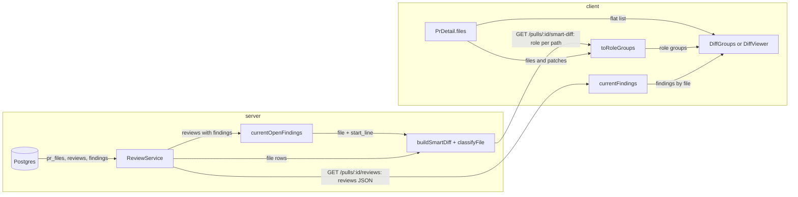

# 05 — Smart Diff

## Goal
On PR → Files changed, show files grouped by review role and, after a review, show its
findings inside the diff. A toggle switches back to the original (GitHub) order.

## Scope
In: `GET /pulls/:id/smart-diff` and the pure classifier
(`server/src/modules/reviews/smart-diff/`), the `tests` value in `SmartDiffRole` (both
`vendor/shared` copies), role groups, inline findings and the order toggle in `client/`.
Out: split suggestions (`too_big` is always `false`, `proposed_splits` is always `[]`),
`pseudocode_summary`, using the classifier to filter the review prompt, DB schema changes.

This file covers both `server/` and `client/`.

## Classification
`classifyFile(path)` looks at the repo-relative path only. Rules are checked in the order
below and the first match wins; a path that matches nothing is `core`. The patterns are in
`smart-diff/constants.ts` (`ROLE_RULES`).

| Checked | Role | Matches |
|---|---|---|
| 1 | `boilerplate` | `*.lock`, `pnpm-lock.yaml`, `package-lock.json`, `yarn.lock`, `dist/`, `build/`, `__snapshots__/`, `*.snap`, `*.generated.*`, `*.min.js` |
| 2 | `tests` | `*.test.*` and `*.spec.*` (JS/TS extensions), `test/`, `tests/`, `__tests__/`, `e2e/` |
| 3 | `wiring` | `index.*` (JS/TS), `*.config.*`, `tsconfig*.json`, `.eslintrc*`, `.env*`, `docker-compose*.yml`/`.yaml`, `.github/`, `.claude/` |
| 4 | `docs` | `*.md`, `*.mdx`, `docs/`, `README*`, `CHANGELOG*`, `LICENSE*` |
| — | `core` | everything else |

The check order differs from the display order: **core → tests → wiring → docs →
boilerplate** (`SMART_DIFF_ROLE_ORDER`).

## Decisions
- **Three edge cases follow from the check order, on purpose:**

| Path | Role | Why |
|---|---|---|
| `src/__tests__/__snapshots__/x.snap` | `boilerplate` | generated output, so boilerplate beats tests |
| `.claude/skills/security/SKILL.md` | `wiring` | configures the agent harness, so wiring beats docs |
| `e2e/README.md` | `tests` | belongs to the test suite, so tests beats docs |

- **`package.json` is `core`:** no pattern lists it.
- **No model call, nothing stored.** The grouping is computed on every request.
- **The route lives in the `reviews` module,** not in a new module, so it reuses
  `ReviewRepository`.
- **"Current review" is the newest `kind='review'` review of each agent.** The rule is
  shared with the PR list (`modules/_shared/current-review.ts`).
- **Severity colours and words come only from `SEV`** in `@devdigest/ui`, so the pill
  says "Critical", not "blocker".
- **Order mode is URL state:** `?order=original`; without it the order is Smart.
- **No order column on `pr_files`.** The server query has no `ORDER BY`, so the order of
  files inside a server group is not guaranteed to be GitHub's. The client orders each
  group by `PrDetail.files` instead.

## Data flow

## API
`GET /pulls/:id/smart-diff` → `SmartDiff`. 404 for an unknown PR or one in another
workspace; 422 for a non-uuid id.

- `groups`: in display order, empty groups left out.
- `files[]`: `path`, `additions`, `deletions`, `finding_lines`.
- `finding_lines`: sorted, unique `start_line`s of the current review's findings for that
  file. Only `kind='finding'` and not dismissed.
- `split_suggestion`: `total_lines` is the sum of additions and deletions; the rest is
  fixed (see Scope).

The server reads the stored `pr_files` and does not call GitHub. Those rows are refreshed
by `GET /pulls/:id`.

## Client behaviour
- **Groups** show a label, hint and file count. `docs` and `boilerplate` start collapsed.
  A group with open findings also shows `● N`, the number of files that have them.
- **Fallback:** while the smart diff is loading or if it failed, the flat list is shown.
  A file the response does not list goes to `core`.
- **Findings** come from `GET /pulls/:id/reviews`, not from `finding_lines`. They appear
  in both orders. Dismissed findings still render as cards but are not counted and do not
  mark the file or line.
- **Inline:** a finding is a `FindingCard` with Accept/Dismiss under the new-file line
  equal to its `start_line`. The line gets a severity bar and pill, and the file header a
  dot.
- **Outside the diff:** a finding whose line is not in the patch is listed in an "outside
  the diff" block at the bottom of its file card (visible when the card is open). A
  finding for a file that is not in the PR's file list is not shown on this tab.
- **Switching order** remounts the file cards, so open/collapsed state goes back to the
  default.
- **Refresh:** reviews and the smart diff are refetched when a run leaves the live list,
  and after accept/dismiss or deleting a run or review.

Code: `client/src/app/repos/[repoId]/pulls/[number]/_components/DiffTab/`,
`client/src/components/diff-viewer/`, `client/src/lib/hooks/reviews.ts`.

## Acceptance criteria
1. Files are grouped core → tests → wiring → docs → boilerplate, with `docs` and
   `boilerplate` collapsed.
2. After a review run, counters, file dots and inline findings appear without a reload.
3. A finding outside the patch is still visible in its file card.
4. "Original order" shows the flat list and is kept in the URL.
5. The three edge cases above and `package.json` classify as listed
   (`server/test/smart-diff-classify.test.ts`).
